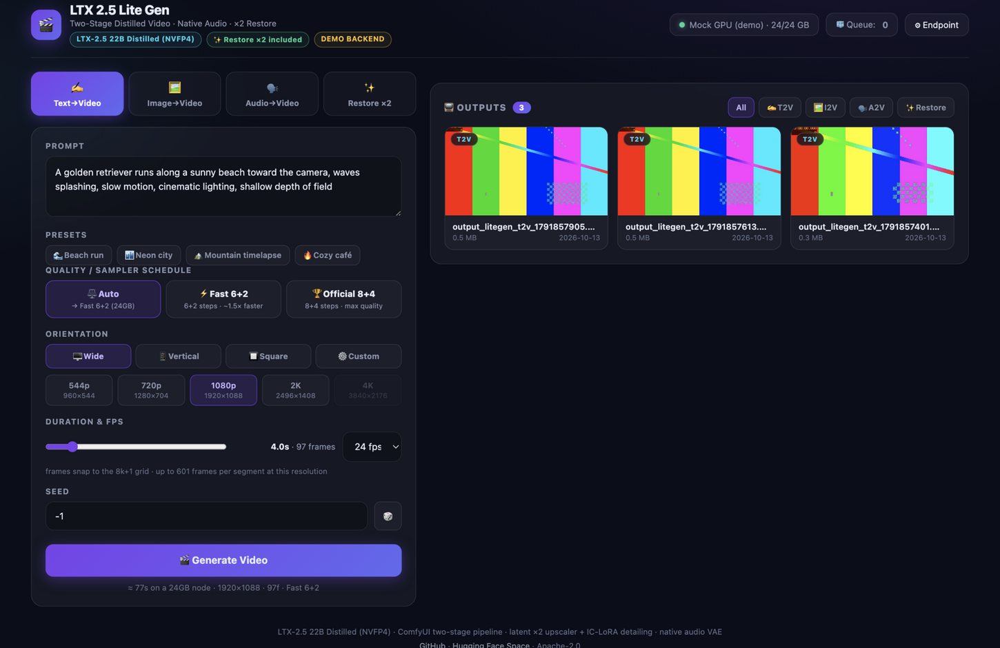
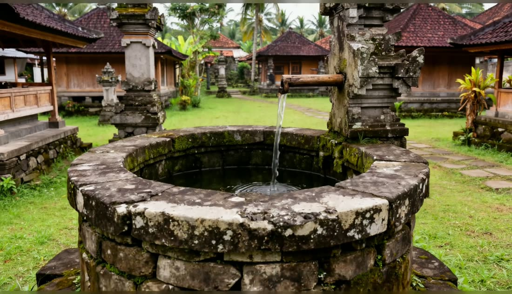
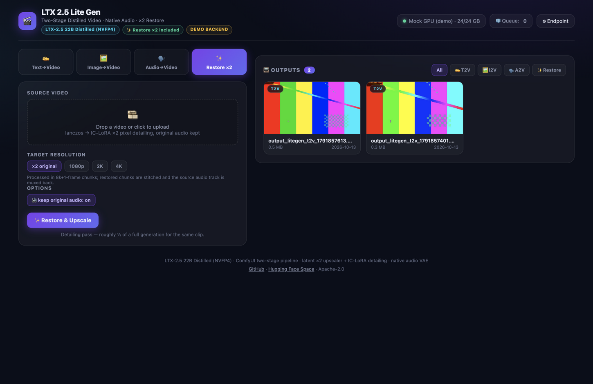

# 🎬 LTX 2.5 Lite Gen

**Self-hosted, production-grade video generation studio** — LTX-2.5 22B **Distilled (NVFP4)** through headless ComfyUI, with a single-file glassmorphism web UI.

| Text→Video | Image→Video | Audio→Video (lip sync) | ×2 Video Restore |
|---|---|---|---|
| ✅ native audio | ✅ native audio | ✅ source audio muxed | ✅ original audio kept |



## Real results (straight from this pipeline)

I2V two-stage distilled, **2560×1472 · 24 fps · native generated audio** — no post-processing. Click a poster to open the player:

| 🌊 Bali coast — aerial drone shot | 🛕 Bali temple — stone fountain |
|---|---|
| [](https://github.com/s3rfdev/ltx25_lite_gen/blob/main/docs/samples/bali_coast_aerial_2k.mp4) | [](https://github.com/s3rfdev/ltx25_lite_gen/blob/main/docs/samples/bali_temple_fountain_2k.mp4) |
| ▶ 6.4 s · 153 frames · I2V | ▶ 8.7 s · 209 frames · I2V |

Both clips are also playable inline in the [Hugging Face Space demo mode](https://huggingface.co/spaces/s3rfdev/ltx25_lite_gen).

- **⚡ Two sampler schedules, hot-switchable per request** — the trimmed **Fast 6+2** (tuned on 24 GB nodes) and the **Official 8+4** two-stage distilled schedule. Auto mode picks by GPU: 24 GB → Fast, 32 GB+ → Official.
- **✨ Restore ×2 is part of the build** — every generation already runs the latent ×2 upscaler + IC-LoRA pixel detailing pass, and a standalone **Restore** tab re-details existing videos up to 4K (lanczos guide → 2-step IC-LoRA pass → original audio muxed back).
- **🖼️ Any resolution from 544p to 4K** — wide / vertical / square presets plus a fully custom W×H input (snapped to the /64 grid the two-stage pipeline requires).
- **🔊 Native sound** — LTX audio VAE generates an AAC track for T2V/I2V; A2V and Restore keep the source audio.
- **🧊 Queue + gallery + GPU telemetry** — in-memory queue (dual-path routes compatible with the full Aether backend), outputs gallery with filters, live VRAM badge.
- **🤗 Free Hugging Face Space** — the Space is the decoupled frontend (`sdk: static`): demo mode built in, point it at your own GPU node via ⚙ Endpoint.

---

## What's inside this build

| Component | File | Size |
|---|---|---|
| DiT — LTX-2.5 22B **Distilled NVFP4** | `ltx-2.5-22b-distilled-transformer-nvfp4.safetensors` | 18.7 GB |
| Text encoder — Gemma4 12B (**heretic nvfp4**, bf16 fallback) | `gemma4-12b-heretic-ltx-2.5-comfy-nvfp4.safetensors` | 9.9 GB |
| Video VAE (**conv** variant — required) | `ltx-2.5-video-vae-conv-bf16.safetensors` | ~1.5 GB |
| Audio VAE (native sound) | `ltx-2.5-audio-vae-bf16.safetensors` | ~2 GB |
| Latent spatial upscaler ×2 | `ltx-2.5-latent-spatial-upscaler-x2-bf16-1.0` | ~1.9 GB |
| IC-LoRA pixel detailing ×2 | `ltx-2.5-22b-ic-lora-pixel-spatial-upscaler-x2-1.0` | 327 MB |

Weights (~60 GB) are **not** baked into the image — the entrypoint downloads them on first node start from the manifest (resumable, idempotent). Lightricks repos are **gated**: `HF_TOKEN` must belong to a user who accepted the [LTX-2.5 license](https://huggingface.co/Lightricks/LTX-2.5). All workflow nodes are **core ComfyUI** — zero custom nodes.

## Sampler quality configs

Both schedules are two-stage distilled runs: stage 1 denoises at half resolution → latent ×2 upscaler → full-res re-injection → stage 2 IC-LoRA detailing. `N sigma values = N−1 steps`.

| | Fast 6+2 | Official 8+4 |
|---|---|---|
| Stage 1 sigmas | `1.0, 0.99375, 0.975, 0.909375, 0.725, 0.421875, 0.0` | `1.0, 0.99375, 0.9875, 0.98125, 0.975, 0.909375, 0.725, 0.421875, 0.0` |
| Stage 1 sampler | `euler_ancestral` | `euler_ancestral_cfg_pp` |
| Stage 2 sigmas | `0.909375, 0.725, 0.0` | `0.85, 0.7250, 0.4219, 0.0` |
| Stage 2 sampler | `euler` | `euler_cfg_pp` |
| Measured (5090 Laptop 24 GB, I2V 97f) | **76 s** @ 1080p · 35 s @ 768p | ~1.45× slower |

The switch patches two `ManualSigmas` + two `KSamplerSelect` nodes of the workflow templates at runtime — `quality=fast|official` on any generate endpoint, or the ⚖️ Auto / ⚡ / 🏆 chips in the UI.

## Resolutions & VRAM

Frames always snap to the **8k+1** grid (`1 + floor(fps·s/8)·8`), resolutions to **/64** (stage-1 runs at half size). Long requests are auto-split into chained segments (each continues from the previous last frame) and stitched losslessly.

| GPU | 1080p | 2K (2496×1408) | 4K (3840×2176) |
|---|---|---|---|
| **24 GB** (3090/4090/A5000/5090 Laptop) | ✅ up to 601 f (25 s @ 24 fps) | ⚠️ works (split-stages + 16 GB swap), 97f ≈ 145–215 s | ❌ |
| **32 GB** (RTX 5090) | ✅ | ✅ 601 f ≈ 411 s | ✅ 177 f ≈ 564 s (peak 28.6 GB) |

The UI reads the GPU class from `/api/build` and disables 4K on 24 GB nodes automatically.

## Quickstart

```bash
# 1) Docker Compose (any NVIDIA host with the Container Toolkit)
cp .env.example .env      # set HF_TOKEN (gated weights!)
docker compose up -d
# Web UI: http://localhost:8000  (first boot downloads ~60 GB of weights)
```

```bash
# 2) SaladCloud (per-second billing, RTX 5090 32GB ≈ $0.48/hr)
python ctl.py salad up --gpu rtx_5090     # 24GB cards: rtx_a5000 / rtx_3090_ti / rtx_4090
python ctl.py salad status                # prints the public URL
```

```bash
# 3) Vast.ai
python ctl.py vast guide                  # copy-paste cheat sheet

# 4) Plain docker run
docker run --gpus all -p 8000:8000 -e HF_TOKEN=hf_xxx \
  -v $PWD/data/models:/home/llm/s3rf s3rfdev/ltx25-lite-gen:latest
```

### Hugging Face Space (free frontend)

The Space ships **no models** — it's the same single-file UI with a built-in demo mode.

```bash
python ctl.py hf push    # syncs index.html + README + demo clip to HF_SPACE_ID
```

Open the Space → **Try demo mode**, or deploy a GPU backend anywhere above and paste its URL into **⚙ Endpoint** (stored in `localStorage`, CORS is open).

## Web UI



- **✍️ Text→Video** — prompt presets, orientation presets, duration slider (8k+1 readout), seed, quality chips.
- **🖼️ Image→Video** — drop a start frame (becomes frame 0), motion prompt, start-frame strength.
- **🗣️ Audio→Video** — portrait + speech audio → lip-synced talking video exactly as long as the audio.
- **✨ Restore ×2** — drop any video → ×2 / 1080p / 2K / 4K detailing pass, original audio preserved, processed in 8k+1-frame chunks.
- Gallery with mode filters, lightbox player, download, delete; live job card with progress + ETA; GPU/queue header; remote-endpoint modal.

## REST API

```bash
# Text→Video (queued; sync mode: background=false)
curl -X POST http://localhost:8000/api/v1/generate/t2v -F prompt="a fox runs in the snow" \
     -F width=1920 -F height=1088 -F duration_seconds=4 -F quality=fast -F background=true

# Image→Video
curl -X POST http://localhost:8000/api/v1/generate/i2v -F image_file=@start.png \
     -F prompt="the scene comes alive" -F duration_seconds=4 -F quality=official -F background=true

# Audio→Video (lip sync)
curl -X POST http://localhost:8000/api/v1/generate/a2v -F image_file=@portrait.png \
     -F audio_file=@speech.wav -F background=true

# Restore existing video to 2K (original audio kept)
curl -X POST http://localhost:8000/api/v1/generate/restore -F video_file=@clip.mp4 \
     -F resolution=2k -F background=true

# Poll / manage
curl http://localhost:8000/api/v1/tasks/<task_id>       # status + progress + meta
curl http://localhost:8000/api/v1/generate/queue/tasks  # queue (dual-path w/ full backend)
curl http://localhost:8000/api/v1/outputs               # gallery JSON
curl http://localhost:8000/api/build                    # what's inside this build
```

| Endpoint | Purpose |
|---|---|
| `GET /` | Web UI (single self-contained HTML) |
| `GET /api/build` | Capability manifest: model, modes, `upscale_included`, quality configs, VRAM class |
| `GET /api/stats` | GPU name + free/total VRAM, queue counters |
| `POST /api/v1/generate/t2v` | prompt → video |
| `POST /api/v1/generate/i2v` | start frame + prompt → video |
| `POST /api/v1/generate/a2v` | portrait + speech audio → talking video |
| `POST /api/v1/generate/lipdub` | full-backend compat alias (`video_file`) |
| `POST /api/v1/generate/restore` | video → ×2/2K/4K detailing, audio preserved |
| `GET /api/v1/tasks/{id}` | extended task status (progress %, meta) |
| `GET|DELETE /api/v1/queue/tasks…` | queue management (dual-path) |
| `GET /api/v1/outputs` · `DELETE /api/v1/outputs/{name}` | gallery JSON / delete |
| `GET /outputs/{file}` · `GET /api/download/{file}` | stream / attachment download |

## Architecture

```
browser ──▶ FastAPI litegen.app :8000 ──▶ in-memory queue ──▶ worker thread
                  │                                            │
                  │                                     LTX25ComfyService / A2V / Restore
                  │                                     (quality sigma patch, part chaining)
                  ▼                                            ▼
            static/index.html ◀── /outputs/*.mp4 ◀── headless ComfyUI :8188
            (glassmorphism UI,                        nvfp4 DiT + gemma4 TE + conv VAE
             localStorage endpoint)                   + audio VAE + latent×2 + IC-LoRA
```

One container, one GPU. Models stay resident between jobs (`LTX25_COMFY_KEEP_RESIDENT=1`, warm 97f I2V ≈ 35 s). Each two-stage generation is split into two ComfyUI prompts (stage 1 → latents → stage 2) to cut the RAM peak on 24 GB nodes.

## Environment

| Var | Default | Purpose |
|---|---|---|
| `HF_TOKEN` | — | **Required.** Gated Lightricks weights (accept the LTX-2.5 license first) |
| `PORT` / `API_PORT` | `8000` | Studio API port (dual-stack `::`) |
| `COMFY_PORT` | `8188` | Headless ComfyUI port |
| `MODEL_DOWNLOAD` | `1` | `0` = skip the manifest download phase |
| `LTX25_COMFY_KEEP_RESIDENT` | `1` | Keep models warm between jobs |
| `LTX25_COMFY_SPLIT_STAGES` | `1` | Two-prompt split (needed for 2K on 24 GB) |
| `LTX25_COMFY_CLIP` | heretic nvfp4 | Text encoder file (bf16 fallback ships in the manifest) |
| `LITEGEN_MOCK` | `0` | `1` = no GPU: jobs return a test clip (UI dev / CI) |

Deployment knobs for `ctl.py`: `SALAD_API_KEY`, `SALAD_ORGANIZATION_NAME`, `SALAD_PROJECT_NAME`, `SALAD_CONTAINER_NAME`, `DOCKER_IMAGE`, `HF_SPACE_ID`, `VAST_API_KEY`.

## Development without a GPU

```bash
pip install -r requirements.txt
LITEGEN_MOCK=1 uvicorn litegen.app:app --port 8000   # full UI + queue on fake jobs
```

`GET /api/build` then reports `backend: "mock"` and the header shows a **DEMO BACKEND** badge — the UI is fully clickable end-to-end.

## Credits & license

- **LTX-2.5** model © Lightricks (gated; your token, your license).
- **ComfyUI** runs headless as the diffusion engine — all LTX/SeedVR2 nodes used here are core.
- Code: Apache-2.0 © 2026 s3rfdev. Sibling project: [qwen_upscaler](https://github.com/s3rfdev/qwen_upscaler) (images) — this repo is the video counterpart in the same "thin repo + fat GPU image + free HF frontend" format.
